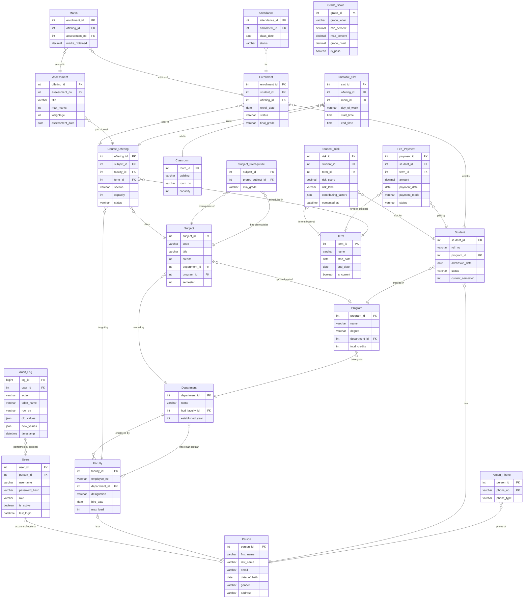

# Education and Academics Management System — ER / EER Conceptual Design and Relational Mapping

## 1. Introduction

This document is the conceptual database design (Part A1 of the coursework) for the
Education and Academics Management System: the entity list, relationships with
cardinalities, Enhanced-ER (EER) features, the eight business rules, the step-by-step
ER-to-relational mapping, and two renderable diagrams (dbdiagram.io DBML and Mermaid
`erDiagram`).

**DBMS-first stance.** MySQL 8 (InnoDB) is the source of truth. Every business rule,
constraint, key, trigger, stored procedure, view and role lives **inside MySQL**. The
Spring Boot backend only calls them with `JdbcTemplate` and hand-written SQL; the React
frontend only displays results; the Python FastAPI service only reads a feature view for
ML. No data-integrity rule is enforced in the application layer unless the database
already enforces it. Derived attributes (`age`, `attendance_percent`, `cgpa`,
`grade_letter`, `enrolled_count`) are **not stored** — they are computed by views and
stored functions. This document is conceptual only; Flyway migrations (a later step)
implement the resulting schema.

Legend for the attribute lists below: **PK** primary key · **FK→X** foreign key to X ·
**//derived** computed, not stored (view/procedure) · **[multivalued→child]** promoted to
a child table · **(unique)** candidate key · **(optional)** nullable · **(composite)**
attribute made of sub-attributes, flattened to columns.

---

## 2. Entity List with Attributes

**1. Department** — strong entity; owns programs, subjects and faculty.
- `department_id` **PK**
- `name` (unique)
- `hod_faculty_id` **FK→Faculty** (optional, circular — see §3; added by `ALTER` / set by a stored procedure after both rows exist)
- `established_year`

**2. Program** — strong entity; belongs to a department.
- `program_id` **PK**
- `name`
- `degree`
- `duration_years`
- `department_id` **FK→Department**
- `total_credits`

**3. Person** — supertype (generalization root).
- `person_id` **PK**
- `first_name`
- `last_name`  (Person **name** is a composite attribute split into `first_name` + `last_name`)
- `email` (unique)
- `date_of_birth`
- `gender`
- `address` **(composite)** → flattened to `address_line`, `city`, `state`, `pin_code`
- `age` **//derived** from `date_of_birth`
- `phone` **[multivalued → Person_Phone]**

**4. Person_Phone** — multivalued attribute of Person promoted to a child table.
- `person_id` **FK→Person** (part of PK)
- `phone_no` (part of PK)
- `phone_type`

**5. Student** — subtype of Person (IS-A, total/disjoint specialization).
- `student_id` **PK** & **FK→Person.person_id**
- `roll_no` (unique)
- `program_id` **FK→Program**
- `admission_date`
- `status`
- `current_semester`
- `cgpa` **//derived** from Marks via Grade_Scale
- `is_detained` **//derived (stored, denormalized)** from attendance_percent (< 75%) — lives on Enrollment, not Attendance, because a MySQL trigger cannot modify the triggering row's own table. Shown here conceptually; stored on Enrollment (see §6).

**6. Faculty** — subtype of Person (IS-A, total/disjoint specialization).
- `faculty_id` **PK** & **FK→Person.person_id**
- `employee_no` (unique)
- `department_id` **FK→Department** (circular with `Department.hod_faculty_id`)
- `designation`
- `hire_date`
- `max_load`

**7. Subject** — strong entity; owned by a department, optionally by a program.
- `subject_id` **PK**
- `code` (unique)
- `title`
- `credits`
- `department_id` **FK→Department**
- `program_id` **FK→Program** (optional)
- `semester`

**8. Subject_Prerequisite** — recursive M:N relationship on Subject (associative).
- `subject_id` **FK→Subject** (part of PK)
- `prereq_subject_id` **FK→Subject** (part of PK)
- `min_grade`
- CHECK: `subject_id <> prereq_subject_id` (a subject cannot be its own prerequisite)

**9. Term** — strong entity (academic period).
- `term_id` **PK**
- `name` (unique)
- `start_date`
- `end_date`
- `is_current`

**10. Classroom** — strong entity (room resource).
- `room_id` **PK**
- `building`
- `room_no`
- `capacity`
- UNIQUE(building, room_no)

**11. Course_Offering** — associative entity for the ternary Subject × Faculty × Term.
- `offering_id` **PK** (surrogate)
- `subject_id` **FK→Subject**
- `faculty_id` **FK→Faculty**
- `term_id` **FK→Term**
- `section`
- `capacity`
- `enrolled_count` **//derived** from Enrollment
- `status`
- UNIQUE(subject_id, faculty_id, term_id, section)

**12. Timetable_Slot** — associative entity (Course_Offering × Classroom + time).
- `slot_id` **PK**
- `offering_id` **FK→Course_Offering**
- `room_id` **FK→Classroom**
- `day_of_week`
- `start_time`
- `end_time`
- CHECK: `end_time > start_time`

**13. Enrollment** — associative entity resolving Student M:N Course_Offering.
- `enrollment_id` **PK**
- `student_id` **FK→Student**
- `offering_id` **FK→Course_Offering**
- `enroll_date`
- `status`
- `final_grade` (stored, denormalized — filled by `sp_compute_final_grades` so transcripts do not recompute weighted marks)
- `is_detained` **//derived (stored, denormalized)** from attendance_percent (< 75%)
- UNIQUE(student_id, offering_id)

**14. Attendance** — depends on Enrollment.
- `attendance_id` **PK** (surrogate; composite candidate key (enrollment_id, class_date))
- `enrollment_id` **FK→Enrollment**
- `class_date`
- `status` (present / absent / late)
- UNIQUE(enrollment_id, class_date)
- `attendance_percent` **//derived** per enrollment (from Attendance rows)

**15. Assessment** — weak entity of Course_Offering (identifying relationship).
- `offering_id` **FK→Course_Offering** (part of PK, identifying owner)
- `assessment_no` (part of PK, partial key — unique only within an offering)
- `title`
- `max_marks`
- `weightage`
- `assessment_date`
- PK = (offering_id, assessment_no)

**16. Marks** — associative entity (Enrollment M:N Assessment).
- `enrollment_id` **FK→Enrollment** (part of PK)
- `offering_id` (part of PK; composite FK → Assessment)
- `assessment_no` (part of PK; composite FK → Assessment)
- `marks_obtained`
- `grade_letter` **//derived** via Grade_Scale
- PK = (enrollment_id, offering_id, assessment_no)
- Composite FK (offering_id, assessment_no) → Assessment(offering_id, assessment_no)
- A `version` column for optimistic locking is added in the migration step (not part of the conceptual PK).

**17. Grade_Scale** — lookup table (soft lookup, no hard FK).
- `grade_id` **PK**
- `grade_letter` (unique)
- `min_percent`
- `max_percent`
- `grade_point`
- `is_pass`
- Ranges cover 0–100 with no gaps/overlaps; 40% is the pass threshold.

**18. Fee_Payment** — strong entity linked to Student/Term.
- `payment_id` **PK**
- `student_id` **FK→Student**
- `term_id` **FK→Term** (optional)
- `amount`
- `payment_date`
- `payment_mode`
- `status`

**19. Users** — application/login accounts (RBAC).
- `user_id` **PK**
- `person_id` **FK→Person** (optional)
- `username` (unique)
- `password_hash`
- `role`
- `is_active`
- `last_login`

**20. Audit_Log** — change history.
- `log_id` **PK**
- `user_id` **FK→Users** (optional)
- `action`
- `table_name`
- `row_pk`
- `old_values` (JSON)
- `new_values` (JSON)
- `timestamp`

**21. Student_Risk** — ML-derived predictions (written by Spring from the ai-service output).
- `risk_id` **PK**
- `student_id` **FK→Student**
- `term_id` **FK→Term** (optional)
- `risk_score`
- `risk_label` (LOW / MEDIUM / HIGH)
- `contributing_factors` (JSON)
- `computed_at`

---

## 3. Relationships with Cardinalities

### 3.1 Standard binary relationships

| Relationship | Cardinality | Description |
| --- | --- | --- |
| Department – Program | 1:N | A department offers many programs; each program belongs to one department. |
| Program – Student | 1:N | A program has many students; each student is admitted to one program. |
| Department – Subject | 1:N | A department owns many subjects; each subject belongs to one department. |
| Program – Subject | 1:N (optional) | A program may list many subjects; `program_id` is optional. |
| Department – Faculty | 1:N | A department employs many faculty; each faculty belongs to one department. |
| Person – Person_Phone | 1:N | A person has many phone numbers (multivalued attribute promoted to a table). |
| Person – Student | 1:1 (IS-A) | Specialization: each student is exactly one person. |
| Person – Faculty | 1:1 (IS-A) | Specialization: each faculty is exactly one person. |
| Subject – Course_Offering | 1:N | A subject is offered many times; each offering is exactly one subject. |
| Faculty – Course_Offering | 1:N | A faculty teaches many offerings; each offering has one faculty. |
| Term – Course_Offering | 1:N | A term contains many offerings; each offering belongs to one term. |
| Course_Offering – Timetable_Slot | 1:N | An offering has many timetable slots; each slot belongs to one offering. |
| Classroom – Timetable_Slot | 1:N | A classroom hosts many slots; each slot is in one classroom. |
| Enrollment – Attendance | 1:N | An enrollment has many attendance rows (one per class date). |
| Student – Fee_Payment | 1:N | A student makes many payments. |
| Term – Fee_Payment | 1:N (optional) | A term groups many payments; `term_id` is optional. |
| Person – Users | 1:1 (optional) | A person may have one login account; `person_id` is optional. |
| Users – Audit_Log | 1:N (optional) | A user performs many log entries; `user_id` is optional. |
| Student – Student_Risk | 1:N | A student has many risk predictions (one per run/term). |
| Term – Student_Risk | 1:N (optional) | A term groups many risk rows; `term_id` is optional. |
| Grade_Scale – (Marks/Student) | lookup (no hard FK) | `grade_letter` and `cgpa` are derived by matching a percentage into `Grade_Scale` ranges inside views/procedures, not by a foreign key. |

### 3.2 Ternary relationship — Course_Offering = Subject × Faculty × Term (associative entity)

A `Course_Offering` is exactly one **Subject** + one **Faculty** + one **Term** (plus a
`section`). A subject is offered many times, a faculty teaches many offerings, and a term
contains many offerings. The natural key is the combination of the three participants plus
`section`; a surrogate `offering_id` is added for convenience with
`UNIQUE(subject_id, faculty_id, term_id, section)`. This is the standard way to map an
n-ary (here ternary) relationship: create one relation whose (partial) key is the union of
the participating entities' keys.

### 3.3 Recursive M:N relationship — Subject prerequisites (via Subject_Prerequisite)

`Subject_Prerequisite(subject_id, prereq_subject_id, min_grade)` is a recursive M:N
relationship on `Subject`: a subject **has** prerequisites and a subject **is a
prerequisite of** other subjects. Both columns reference `subject.subject_id`; the PK is
`(subject_id, prereq_subject_id)`; a CHECK forbids `subject_id = prereq_subject_id`.

### 3.4 Circular relationship — Faculty ↔ Department HOD

There are two relationships between `Department` and `Faculty`:
- **Department employs Faculty** (1:N): `Faculty.department_id → Department.department_id`.
- **Department has HOD = one Faculty** (1:1, optional): `Department.hod_faculty_id → Faculty.faculty_id`.

These two foreign keys form a **cycle**: a department's HOD is a faculty, but that faculty
belongs to a department. You cannot insert both rows with both FKs NOT NULL at once
(chicken-and-egg). Resolution:
1. Make `Department.hod_faculty_id` **nullable**.
2. Insert the department with `hod_faculty_id = NULL`, insert the faculty with its
   `department_id` set, then `UPDATE department SET hod_faculty_id = ?` (or call a stored
   procedure `sp_assign_hod`) once both rows exist.
3. The HOD foreign key itself is added by a later `ALTER` migration (V3) after both tables
   exist, which also avoids the creation-order cycle.

### 3.5 Associative relationship — Enrollment resolves Student M:N Course_Offering

`Student M:N Course_Offering` is resolved by the associative entity `Enrollment`, which
carries its own attributes (`enroll_date`, `status`, `final_grade`, `is_detained`) and a
`UNIQUE(student_id, offering_id)` constraint so a student is enrolled in an offering at most
once. `Attendance` and `Marks` then hang off `Enrollment`.

---

## 4. EER Features

- **Specialization / generalization (Person → Student and Faculty).** `Person` is a
  supertype; `Student` and `Faculty` are disjoint, total subtypes (every person is exactly
  one of student or faculty). Mapped with the **IS-A (PK-also-FK)** pattern: each subtype's
  PK is also a foreign key to `Person.person_id`, so a student/faculty row cannot exist
  without a matching person row. (Alternative single-table-with-discriminator was rejected
  to keep the subtype attributes clean and to show the EER concept.)

- **Multivalued attribute (phone).** A person can have several phone numbers. The
  multivalued `phone` attribute is promoted to its own table `Person_Phone` with PK
  `(person_id, phone_no)`.

- **Derived attributes (not stored).** `age` (from `date_of_birth`),
  `attendance_percent` (from `Attendance`), `cgpa` (from `Marks` via `Grade_Scale`),
  `grade_letter` (from a mark's percentage via `Grade_Scale`), and `enrolled_count` (from
  `Enrollment`) are computed by views and stored functions (`fn_cgpa`, `fn_attendance_pct`,
  `fn_grade_point`) rather than stored as columns. The only deliberate denormalizations are
  `Enrollment.final_grade` and `Enrollment.is_detained`, filled by procedures/triggers so
  transcripts and detention checks do not recompute on every read.

- **Weak-entity style (Assessment).** `Assessment` is a weak entity of `Course_Offering`,
  identified by its owner: PK = `(offering_id, assessment_no)` where `assessment_no` is a
  partial key (unique only within an offering). `Marks` is the associative entity between
  `Enrollment` and `Assessment` (Enrollment M:N Assessment).

---

## 5. The 8 Business Rules

| # | Rule | Constrains | Enforced in MySQL as |
| --- | --- | --- | --- |
| 1 | 26-credit limit — a student may not enroll in subjects totaling more than 26 credits in a term. | Enrollment (per student per term) | `BEFORE INSERT` trigger on Enrollment (and/or inside `sp_enroll_student`) summing `subject.credits` for the student's offerings in that term; `SIGNAL SQLSTATE '45000'` if the sum exceeds 26. |
| 2 | Prerequisites passed — a student may not enroll unless all prerequisites are passed with at least `min_grade`. | Enrollment vs Subject_Prerequisite + Marks | `BEFORE INSERT` trigger on Enrollment checking, for each `Subject_Prerequisite` of the subject, that a prior `Marks`/grade for that prerequisite meets `min_grade`. |
| 3 | Capacity — an offering's enrolled_count cannot exceed its capacity. | Enrollment vs Course_Offering | `BEFORE INSERT` trigger on Enrollment (`COUNT(*) < capacity`); `sp_enroll_student` uses `SELECT ... FOR UPDATE` on the offering row to make the check atomic under concurrency. |
| 4 | No faculty or room double-booking — a faculty cannot be in two overlapping slots; a classroom cannot host two overlapping slots (same day + overlapping time window). | Timetable_Slot | `BEFORE INSERT` trigger on Timetable_Slot querying existing slots for the same faculty (or same room) on the same `day_of_week` whose `[start_time, end_time)` overlaps the new slot; `SIGNAL` if any clash. |
| 5 | 75% attendance detention — a student below 75% attendance in an offering is detained / not eligible for the final exam. | Attendance / Enrollment | `AFTER INSERT/UPDATE` trigger on Attendance recomputes `attendance_percent` via `fn_attendance_pct` and sets `Enrollment.is_detained = 1` below 75%; `v_attendance_summary` exposes the shortage flag. (The flag lives on Enrollment because a trigger cannot modify its own table.) |
| 6 | 40% pass mark with grade scale — passing requires ≥ 40% per Grade_Scale; a mark's grade letter is matched by percentage into Grade_Scale ranges. | Marks / grade via Grade_Scale | `CHECK` on `Grade_Scale` ranges (no gaps/overlaps, 40% threshold with `is_pass`); `sp_compute_final_grades` and `fn_grade_point` map a percentage into the matching `Grade_Scale` row. |
| 7 | Marks not above max — `marks_obtained ≤ max_marks` for the referenced Assessment. | Marks vs Assessment | `BEFORE INSERT/UPDATE` trigger on Marks (a `CHECK` cannot compare across rows/tables) comparing `marks_obtained` to the referenced `Assessment.max_marks`. |
| 8 | Assessment weightage ≤ 100 — the sum of `weightage` across all assessments of an offering must be ≤ 100 (each weightage ≥ 0). | Assessment per offering | `CHECK (weightage >= 0)` on Assessment; `BEFORE INSERT/UPDATE` trigger summing `weightage` for the offering and `SIGNAL` if the total exceeds 100. |

---

## 6. ER-to-Relational Mapping, Step by Step

### 6.1 Mapping algorithm (standard)

1. **Strong entities** → one relation each; atomic attributes become columns; composite
   attributes are flattened to their parts; choose a PK; **derived attributes are not
   mapped** to columns (computed in views/functions).
2. **Weak entities** → one relation with PK = (identifying owner's PK, partial key); the
   identifying relationship is merged in (the owner PK is a FK and part of the weak
   entity's PK).
3. **1:1 binary** → place the FK on the side with total participation (or the side that
   avoids NOT NULL ordering problems) and add `UNIQUE`; or merge both into one relation.
4. **1:N binary** → place the FK on the N side referencing the 1 side.
5. **M:N binary** → new relation with PK = (PK_A, PK_B), both columns also FKs.
6. **Multivalued attributes** → new relation with PK = (entity PK, attribute value).
7. **n-ary (ternary) relationships** → new relation with PK = combination of the
   participating PKs (optionally a surrogate PK plus a `UNIQUE` on the natural key).
8. **Specialization (EER)** → chosen here: **IS-A (PK-also-FK) subtype tables** for the
   total/disjoint Person→Student/Faculty. (Alternatives: single table with a discriminator
   column, or class-table inheritance — not used.)
9. **Derived attributes** → not mapped to columns; implemented as views/stored functions.

### 6.2 Applied mapping (resulting tables)

**Strong entities (algorithm step 1):**
- `department(department_id PK, name UNIQUE, hod_faculty_id FK→faculty NULLABLE, established_year)` — `hod_faculty_id` added by `ALTER` (circular, step 3 below).
- `program(program_id PK, name, degree, duration_years, department_id FK→department, total_credits)`
- `person(person_id PK, first_name, last_name, email UNIQUE, date_of_birth, gender, address_line, city, state, pin_code)` — `age` derived (not stored); `address` composite flattened.
- `subject(subject_id PK, code UNIQUE, title, credits, department_id FK→department, program_id FK→program NULLABLE, semester)` — CHECK `credits BETWEEN 1 AND 6`.
- `term(term_id PK, name UNIQUE, start_date, end_date, is_current)`
- `classroom(room_id PK, building, room_no, capacity)` — UNIQUE(building, room_no); CHECK `capacity > 0`.
- `grade_scale(grade_id PK, grade_letter UNIQUE, min_percent, max_percent, grade_point, is_pass)` — lookup, no hard FK.
- `fee_payment(payment_id PK, student_id FK→student, term_id FK→term NULLABLE, amount, payment_date, payment_mode, status)`
- `users(user_id PK, person_id FK→person NULLABLE, username UNIQUE, password_hash, role, is_active, last_login)`
- `audit_log(log_id PK, user_id FK→users NULLABLE, action, table_name, row_pk, old_values JSON, new_values JSON, timestamp)`
- `student_risk(risk_id PK, student_id FK→student, term_id FK→term NULLABLE, risk_score, risk_label, contributing_factors JSON, computed_at)`

**Multivalued attribute (step 6):**
- `person_phone(person_id FK→person, phone_no, phone_type)` — PK(person_id, phone_no).

**Specialization / IS-A (step 8):**
- `student(student_id PK & FK→person, roll_no UNIQUE, program_id FK→program, admission_date, status, current_semester)` — `cgpa` derived (not stored).
- `faculty(faculty_id PK & FK→person, employee_no UNIQUE, department_id FK→department, designation, hire_date, max_load)` — circular with department.hod_faculty_id.

**Recursive M:N (step 5):**
- `subject_prerequisite(subject_id FK→subject, prereq_subject_id FK→subject, min_grade)` — PK(subject_id, prereq_subject_id); CHECK `subject_id <> prereq_subject_id`.

**Ternary / associative (step 7):**
- `course_offering(offering_id PK surrogate, subject_id FK→subject, faculty_id FK→faculty, term_id FK→term, section, capacity, status)` — UNIQUE(subject_id, faculty_id, term_id, section); CHECK `capacity > 0`; `enrolled_count` derived (not stored).

**1:N (step 4):**
- `timetable_slot(slot_id PK, offering_id FK→course_offering, room_id FK→classroom, day_of_week, start_time, end_time)` — CHECK `end_time > start_time`.

**M:N associative — Student × Course_Offering (step 5):**
- `enrollment(enrollment_id PK, student_id FK→student, offering_id FK→course_offering, enroll_date, status, final_grade, is_detained)` — UNIQUE(student_id, offering_id). (`final_grade`, `is_detained` are deliberate denormalizations.)

**1:N dependent (step 4):**
- `attendance(attendance_id PK, enrollment_id FK→enrollment, class_date, status)` — UNIQUE(enrollment_id, class_date); `attendance_percent` derived (not stored).

**Weak entity (step 2) + associative (step 5):**
- `assessment(offering_id FK→course_offering, assessment_no, title, max_marks, weightage, assessment_date)` — PK(offering_id, assessment_no) (weak entity, identifying owner = Course_Offering); CHECK `weightage >= 0`; total weightage ≤ 100 via trigger.
- `marks(enrollment_id FK→enrollment, offering_id, assessment_no, marks_obtained)` — PK(enrollment_id, offering_id, assessment_no); composite FK (offering_id, assessment_no) → assessment(offering_id, assessment_no); `grade_letter` derived (not stored); `marks_obtained ≤ max_marks` via trigger.

**Circular FK resolution (step 3):**
- `faculty.department_id → department.department_id` (created with the table).
- `department.hod_faculty_id → faculty.faculty_id` (nullable; added by a later `ALTER` migration; set via a stored procedure after both rows exist).

This yields exactly the 21 relations in §2 and the diagrams in §7–§8.

---

## 7. dbdiagram.io DBML

Paste the block below into https://dbdiagram.io/d to render the schema. All names are
lowercase snake_case to match the relational mapping. Derived attributes are intentionally
not columns. The circular FKs (`department.hod_faculty_id → faculty.faculty_id` and
`faculty.department_id → department.department_id`) and the recursive prerequisite (two
refs to `subject`) are included.

```dbml
// Education and Academics Management System — dbdiagram.io DBML
// Derived attributes (age, attendance_percent, cgpa, grade_letter, enrolled_count)
// are NOT stored and are omitted from the diagram.

Table department {
  department_id int [pk, increment]
  name varchar(100) [not null, unique]
  hod_faculty_id int [null, ref: > faculty.faculty_id, note: 'Circular FK, nullable. Added by ALTER; set by a stored procedure after both rows exist.']
  established_year int [not null]
}

Table program {
  program_id int [pk, increment]
  name varchar(120) [not null]
  degree varchar(20) [not null]
  duration_years int [not null]
  department_id int [not null, ref: > department.department_id]
  total_credits int [not null]
}

Table person {
  person_id int [pk, increment]
  first_name varchar(60) [not null]
  last_name varchar(60) [not null]
  email varchar(120) [not null, unique]
  date_of_birth date [not null]
  gender varchar(10)
  address_line varchar(200)
  city varchar(60)
  state varchar(60)
  pin_code varchar(10)
  // age is derived from date_of_birth — not stored
}

Table person_phone {
  person_id int [pk, ref: > person.person_id]
  phone_no varchar(15) [pk]
  phone_type varchar(20)
}

Table student {
  student_id int [pk, ref: > person.person_id]
  roll_no varchar(20) [not null, unique]
  program_id int [not null, ref: > program.program_id]
  admission_date date [not null]
  status varchar(20) [not null]
  current_semester int [not null]
  // cgpa is derived from Marks via Grade_Scale — not stored
}

Table faculty {
  faculty_id int [pk, ref: > person.person_id]
  employee_no varchar(20) [not null, unique]
  department_id int [not null, ref: > department.department_id]
  designation varchar(40)
  hire_date date [not null]
  max_load int
}

Table subject {
  subject_id int [pk, increment]
  code varchar(15) [not null, unique]
  title varchar(120) [not null]
  credits int [not null]
  department_id int [not null, ref: > department.department_id]
  program_id int [null, ref: > program.program_id]
  semester int [not null]
}

Table subject_prerequisite {
  subject_id int [pk, ref: > subject.subject_id]
  prereq_subject_id int [pk, ref: > subject.subject_id]
  min_grade varchar(2) [not null]
  // CHECK (subject_id <> prereq_subject_id) enforced in DDL
}

Table term {
  term_id int [pk, increment]
  name varchar(40) [not null, unique]
  start_date date [not null]
  end_date date [not null]
  is_current boolean [not null]
}

Table classroom {
  room_id int [pk, increment]
  building varchar(40) [not null]
  room_no varchar(10) [not null]
  capacity int [not null]
  Indexes {
    (building, room_no) [unique]
  }
}

Table course_offering {
  offering_id int [pk, increment]
  subject_id int [not null, ref: > subject.subject_id]
  faculty_id int [not null, ref: > faculty.faculty_id]
  term_id int [not null, ref: > term.term_id]
  section varchar(5) [not null]
  capacity int [not null]
  status varchar(20) [not null]
  // enrolled_count is derived from Enrollment — not stored
  Indexes {
    (subject_id, faculty_id, term_id, section) [unique]
  }
}

Table timetable_slot {
  slot_id int [pk, increment]
  offering_id int [not null, ref: > course_offering.offering_id]
  room_id int [not null, ref: > classroom.room_id]
  day_of_week varchar(10) [not null]
  start_time time [not null]
  end_time time [not null]
  // CHECK (end_time > start_time) enforced in DDL
}

Table enrollment {
  enrollment_id int [pk, increment]
  student_id int [not null, ref: > student.student_id]
  offering_id int [not null, ref: > course_offering.offering_id]
  enroll_date date [not null]
  status varchar(20) [not null]
  final_grade varchar(2)
  is_detained boolean [not null, default: false, note: 'Derived from attendance_percent < 75%; stored here because a trigger cannot modify its own table.']
  Indexes {
    (student_id, offering_id) [unique]
  }
}

Table attendance {
  attendance_id int [pk, increment]
  enrollment_id int [not null, ref: > enrollment.enrollment_id]
  class_date date [not null]
  status varchar(10) [not null]
  Indexes {
    (enrollment_id, class_date) [unique]
  }
  // attendance_percent is derived per enrollment — not stored
}

Table assessment {
  offering_id int [pk, ref: > course_offering.offering_id]
  assessment_no int [pk]
  title varchar(100) [not null]
  max_marks int [not null]
  weightage int [not null]
  assessment_date date
  // Weak entity: PK = (offering_id, assessment_no). Sum of weightage <= 100 enforced by trigger.
}

Table marks {
  enrollment_id int [pk, ref: > enrollment.enrollment_id]
  offering_id int [pk]
  assessment_no int [pk]
  marks_obtained decimal(6,2) [not null]
  // grade_letter is derived via Grade_Scale — not stored.
  // A version column for optimistic locking is added in the migration step.
}

Ref: marks.(offering_id, assessment_no) > assessment.(offering_id, assessment_no)

Table grade_scale {
  grade_id int [pk, increment]
  grade_letter varchar(2) [not null, unique]
  min_percent decimal(5,2) [not null]
  max_percent decimal(5,2) [not null]
  grade_point decimal(3,1) [not null]
  is_pass boolean [not null]
  Indexes {
    (min_percent, max_percent) [unique]
  }
}

Table fee_payment {
  payment_id int [pk, increment]
  student_id int [not null, ref: > student.student_id]
  term_id int [null, ref: > term.term_id]
  amount decimal(10,2) [not null]
  payment_date date [not null]
  payment_mode varchar(20) [not null]
  status varchar(20) [not null]
}

Table users {
  user_id int [pk, increment]
  person_id int [null, ref: > person.person_id]
  username varchar(60) [not null, unique]
  password_hash varchar(255) [not null]
  role varchar(20) [not null]
  is_active boolean [not null]
  last_login datetime
}

Table audit_log {
  log_id bigint [pk, increment]
  user_id int [null, ref: > users.user_id]
  action varchar(30) [not null]
  table_name varchar(60) [not null]
  row_pk varchar(60)
  old_values json
  new_values json
  timestamp datetime [not null]
}

Table student_risk {
  risk_id int [pk, increment]
  student_id int [not null, ref: > student.student_id]
  term_id int [null, ref: > term.term_id]
  risk_score decimal(5,2) [not null]
  risk_label varchar(10) [not null]
  contributing_factors json
  computed_at datetime [not null]
}
```

Rendering notes: the two circular FKs render as two arrows between `department` and
`faculty`; the recursive prerequisite renders as two arrows from `subject_prerequisite` into
`subject`. `grade_scale` has no relationship lines because it is a soft lookup.

---

## 8. Mermaid erDiagram

Paste the block below into any Mermaid renderer (e.g. the Mermaid Live Editor). Entity
names match the schema. The ternary is shown as the `Course_Offering` associative entity
with 1:N links to `Subject`, `Faculty` and `Term`; the recursive prerequisite is shown as
two refs from `Subject_Prerequisite` to `Subject`; the circular HOD is the second
`Department`↔`Faculty` line; `Enrollment` and `Marks` are associative entities; the
Person→Student/Faculty specialization is shown with `is-a` links.



Rendering notes: `}o--||` is many-to-one (child on the left, parent on the right);
`|o--||` is the IS-A specialization (subtype on the left); `|o--o|` is an optional 1:1 (HOD,
Person↔Users); `}o--o|` is a 1:N with an optional parent (optional FK). All relationship
labels are quoted so the parenthesized notes render correctly.
